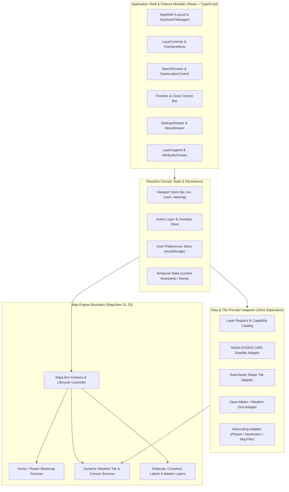

# Technical Architecture — Earth Monitor

## 1. High-Level Architecture Overview

**Earth Monitor** is architected as a modular, client-centric spatial web application built on **Next.js (App Router)**, **React**, **TypeScript (Strict Mode)**, and **MapLibre GL JS**.

In accordance with YAGNI and explicit product boundaries, the system does **not** include a database, user authentication system, or standalone backend microservice. Map rendering is strictly decoupled from weather and geographic data retrieval through a typed **Provider Adapter Layer**.



---

## 2. Technology Stack & Architectural Trade-Offs

| Layer | Selected Technology | Rationale & Trade-Off Analysis |
| :--- | :--- | :--- |
| **Framework** | **Next.js (App Router, latest LTS)** | Provides zero-config TypeScript compilation, route-based code splitting, metadata/SEO tags, and optional serverless Route Handlers (`/api/*`) if future weather providers require server-side caching or API key shielding. *Trade-off*: MapLibre GL JS requires browser `window`/`WebGLContext`, so the map canvas is mounted via a dedicated `"use client"` boundary with dynamic client-only rendering. |
| **UI Library** | **React + TypeScript (`strict: true`)** | Component model maps naturally to floating HUD controls, drawers, and legends. Strict TypeScript (`noUncheckedIndexedAccess: true`) prevents coordinate, unit-conversion, and null-reference bugs. |
| **Map Engine** | **MapLibre GL JS (`maplibre-gl`)** | Open-source (BSD-3-Clause), GPU-accelerated WebGL2 vector and raster tile renderer forked from Mapbox GL JS v1. Supports custom raster tile sources, GeoJSON vector overlays, custom WebGL shader layers (for Phase 2 wind particles), and globe/mercator projections without proprietary per-map-load SDK fees. *Alternative considered*: Leaflet (simpler, but lacks native vector tile rendering, smooth fractional zoom, and WebGL shader integration). |
| **Styling** | **Tailwind CSS + CSS Variables** | Enables rapid, consistent implementation of dark glassmorphic surfaces (`backdrop-blur-md bg-slate-900/80`), responsive breakpoints (`md:`, `lg:`), and accessible focus states with zero runtime CSS-in-JS overhead. |
| **State Management** | **React Context + Custom Hooks (or lightweight Zustand store)** | Keeps viewport coordinates, active layer, overlay toggles, and unit settings synchronized across independent floating panels without prop drilling or heavy Redux boilerplate. |
| **Testing** | **Vitest + React Testing Library + Playwright** | Vitest provides fast unit/integration execution for pure coordinate math, unit conversions, and adapter parsing; Playwright verifies real browser WebGL canvas mounting, responsive layouts (`1280×720` vs `390×844`), and network failure resilience. |
| **Deployment** | **Vercel** | Native Next.js hosting, automatic Preview Deployments for every Pull Request branch, global CDN edge caching, and zero-downtime rollbacks. |

---

## 3. Modular Feature Boundaries & Directory Structure

All application code is organized by domain feature boundary under `src/`:

```text
src/
├── app/                        # Next.js App Router entrypoints, global CSS, metadata
│   ├── layout.tsx
│   ├── page.tsx
│   └── globals.css
├── features/
│   ├── shell/                  # Application shell, floating layout slots, hotkeys, notices
│   │   ├── components/         # AppShell, TopBrandBar, RightUtilityToolbar, BannerNotice
│   │   └── hooks/              # useKeyboardShortcuts, useActiveDrawer
│   ├── map/                    # MapLibre GL JS engine, viewport state, scale, coordinates
│   │   ├── components/         # MapCanvas, ZoomControlGroup, ScaleBar, CoordinateReadout, CrosshairOverlay
│   │   ├── hooks/              # useMapInstance, useViewportUrlSync, useGraticuleLayer
│   │   └── types.ts            # ViewportState, MapBounds, CoordinateFormat
│   ├── search/                 # Location search drawer, geocoding client, browser geolocation
│   │   ├── components/         # SearchDrawer, SearchResultList, GeolocationButton
│   │   ├── adapters/           # geocodingAdapter.ts (Photon / Nominatim / MapTiler)
│   │   └── types.ts            # GeocodingResult, RecentSearchItem
│   ├── layers/                 # Layer selector sidebar/FAB, overlay toggles, legends, attribution
│   │   ├── components/         # LayerControlPanel, MapOverlaysPopover, LayerLegend, AttributionFooter
│   │   ├── registry/           # layerRegistry.ts (declarative catalog of base & weather layers)
│   │   └── types.ts            # LayerDefinition, OverlayDefinition, LegendScale
│   ├── weather-adapters/       # Pure data & tile URL adapters (decoupled from MapLibre DOM)
│   │   ├── nasaGibsAdapter.ts  # NASA EOSDIS GIBS WMTS/XYZ satellite tile resolver
│   │   ├── rainViewerAdapter.ts# RainViewer live radar timestamp & tile URL resolver
│   │   ├── openMeteoAdapter.ts # Open-Meteo point/grid forecast adapter
│   │   └── types.ts            # WeatherTileSource, LayerTimestampMetadata
│   ├── timeline/               # Clock/Timeline bar & temporal playback state
│   │   ├── components/         # TimeControlBar
│   │   └── types.ts            # TimeControlState, PlaybackSpeed
│   └── settings/               # User preferences drawer, About drawer, unit converters
│       ├── components/         # SettingsDrawer, AboutDrawer
│       ├── utils/              # unitConverters.ts (°C/°F, km/h/mph/knots, DMS/Decimal)
│       └── types.ts            # UserPreferences
└── shared/                     # Reusable, domain-agnostic UI primitives & utilities
    ├── components/             # IconButton, SegmentedControl, GlassPanel, LoadingSpinner
    └── utils/                  # debounce.ts, storage.ts, fetchWithTimeout.ts
```

---

## 4. Data-Flow & Separation of Concerns

### 4.1 Strict Separation Between Map Rendering and Weather Data Retrieval
1. **Weather Data Adapters (`src/features/weather-adapters/`)** are pure TypeScript modules. They know **nothing** about MapLibre GL JS or React components. They fetch provider metadata (such as available radar timestamps from RainViewer or valid WMTS date strings for NASA GIBS), validate the JSON response, and return a standardized `ResolvedLayerSource` object:
   ```ts
   export interface ResolvedLayerSource {
     layerId: string;
     tileUrlTemplates: readonly string[];
     tileSize: 256 | 512;
     minZoom: number;
     maxZoom: number;
     timestampIso: string | null;
     attributionHtml: string;
      attributionText: string;
   }
   ```
2. **Map Engine (`src/features/map/`)** subscribes to the active `ResolvedLayerSource` and applies MapLibre `map.addSource()` / `map.addLayer()` / `map.setLayoutProperty()` operations idempotently.

### 4.2 URL & LocalStorage State Synchronization
- **URL Query State (`?lat=22.22&lon=78.49&z=5.0&layer=satellite`)**: Updated via `window.history.replaceState` (debounced at `400ms` after `moveend`) so users can bookmark or share an exact map view and active layer.
- **`localStorage` State (`em_preferences_v1`, `em_recent_searches_v1`)**: Read safely after client hydration with schema fallback defaults so SSR and initial client render never mismatch.

---

## 5. Mapping, Geocoding, and Weather Data Provider Evaluation

A core requirement is that **no simulated data is presented as live weather** and **Zoom Earth's internal APIs are never reused**. Below is the verified provider architecture and licensing evaluation:

| Capability | Primary Provider (V1) | Fallback / Alternative | Licensing & Attribution Requirement | API Limits, Freshness & Coverage |
| :--- | :--- | :--- | :--- | :--- |
| **Vector Basemap, Borders & Place Labels** | **OpenFreeMap** (`https://tiles.openfreemap.org`) or **CARTO Basemaps** (`Dark Matter`) | **MapTiler** (Free tier with API key) | **OpenFreeMap**: Free, open-source, no API key required; requires `© OpenMapTiles © OpenStreetMap contributors`. **CARTO**: Free for non-commercial/public evaluation with `© OpenStreetMap contributors © CARTO`. | Global vector coverage (`z=0` to `z=14+`); static cartographic styles allowing custom dark theme and independent border/label layer toggling. |
| **Satellite Imagery Layer (`Satellite`)** | **NASA EOSDIS GIBS** (`gibs.earthdata.nasa.gov`) | **ESRI World Imagery** (static aerial/satellite basemap) | **Public Domain (NASA Open Data Policy)**. Requires attribution: `Imagery provided by services from NASA's Global Imagery Browse Services (GIBS), part of NASA's Earth Observing System Data and Information System (EOSDIS)`. | Free, no API key required. Global coverage (`MODIS Terra/Aqua CorrectedReflectance_TrueColor`, `VIIRS_SNPP_CorrectedReflectance_TrueColor`, `GOES-East/West`, `Himawari`). Updated daily (polar) or sub-hourly (geostationary). |
| **Live Weather Radar Layer (`Radar`)** | **RainViewer Public Weather Maps API** (`https://api.rainviewer.com/public/weather-maps.json`) | **NOAA/NWS Ridge II WMS** (US coverage) | Free public API for weather radar visualization; requires visible attribution link to `RainViewer`. | Returns past 2 hours of global composite radar timestamps (10-min intervals) and XYZ raster tile templates (`256×256` or `512×512` PNG/WebP, max zoom `z=7`–`10`). |
| **Point Weather & Forecast Data (`Temperature`, `Wind`, `Precipitation`)** | **Open-Meteo API** (`https://api.open-meteo.com/v1/forecast`) | **NOAA NOMADS / NWS API** | **CC BY 4.0** (free for non-commercial use; <10,000 requests/day without API key). Requires attribution: `Weather data by Open-Meteo.com` (and upstream models DWD ICON / NOAA GFS / ECMWF). | Global coverage (`1–11 km` resolution combining DWD ICON, NOAA GFS, ECMWF IFS); hourly & 15-min updates; no API key required. *Note*: Open-Meteo provides JSON point/grid data rather than pre-rendered XYZ color tiles; V1 uses it for live city/point badges and location weather inspection while raster forecast tile pipelines are evaluated for Phase 2. |
| **Location Search & Geocoding (`Search`)** | **Photon (Komoot)** (`https://photon.komoot.io/api/`) | **Nominatim (OSM)** (`https://nominatim.openstreetmap.org/search`) | **ODbL (OpenStreetMap)**. Requires attribution: `Search data © OpenStreetMap contributors`. | Free, no API key required. Photon is explicitly designed for interactive type-ahead autocomplete (`q=...&limit=8`). Client enforces `300ms` debounce and `AbortController` to respect fair-use limits. |

---

## 6. Error Handling, Resilience & Security

1. **Network & Tile Failure Isolation**:
   - MapLibre's `map.on('error', ...)` listener catches tile HTTP 404/5xx errors without unmounting the React tree.
   - Repeated tile errors for an active weather overlay trigger a non-blocking `<BannerNotice variant="warning">` (`"Weather imagery from [Provider] is temporarily unavailable. Showing base map."`) with a `"Retry"` button.
2. **Request Timeouts & Cancellation**:
   - All `fetch` calls in geocoding and weather metadata adapters use `AbortController` with a strict `8,000ms` timeout and automatic cancellation on component unmount or superseded search queries.
3. **Strict Runtime Validation**:
   - External JSON responses (RainViewer `weather-maps.json`, Photon GeoJSON features, Open-Meteo forecast responses) are validated before consumption so malformed upstream responses fail gracefully into the panel error state (`"Unable to load" + "Try Again"`).
4. **Security Posture**:
   - Content Security Policy (CSP) headers configured in `next.config.ts` restricting `connect-src` and `img-src` to approved map/weather tile origins (`*.openfreemap.org`, `*.basemaps.cartocdn.com`, `gibs.earthdata.nasa.gov`, `*.rainviewer.com`, `api.open-meteo.com`, `photon.komoot.io`).
   - Zero inline `eval` (save for `wasm-unsafe-eval` / `blob:` workers required by MapLibre GL JS Web Workers).

---

## 7. Deployment Design

- **Target Platform**: **Vercel** connected to `https://github.com/Itzx-kush/earth-monitor`.
- **Branch & PR Workflow**:
  - `main` branch represents production-ready, deployable state.
  - Every milestone task is developed on a scoped feature branch (`feat/...`, `fix/...`, `docs/...`) and verified via automated checks (`typecheck`, `lint`, `test`, `build`) and a Vercel Preview URL before merging via Pull Request.
- **Environment Configuration**:
  - V1 requires **zero mandatory secret keys** out-of-the-box by defaulting to keyless open providers (OpenFreeMap, NASA GIBS, RainViewer, Open-Meteo, Photon).
  - Optional environment variables (`NEXT_PUBLIC_MAPTILER_KEY`, `NEXT_PUBLIC_DEFAULT_LAT`, `NEXT_PUBLIC_DEFAULT_LON`, `NEXT_PUBLIC_DEFAULT_ZOOM`) are documented in `.env.example` for custom tile hosting upgrades.
