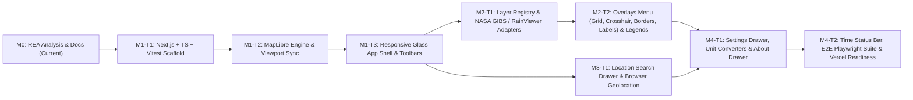

# Implementation Plan — Earth Monitor

## 1. Engineering Workflow & Branching Policy

All implementation work follows a strict, incremental software engineering process:
1. **One Feature Per Branch & Pull Request**: Every task below corresponds to a dedicated Git branch (`feat/m1-t1-nextjs-scaffold`, etc.) and a focused Pull Request against `main`.
2. **Test-First Verification**: No branch may be merged until `npm run typecheck`, `npm run lint`, `npm run test`, and `npm run build` succeed without errors.
3. **No Unverified Data**: Only real, documented tile and meteorological endpoints may be wired into adapters.

---

## 2. Ordered Milestones & Independently Testable Tasks

### Milestone 0: REA Reference Analysis & Engineering Foundation (COMPLETED IN THIS PR)
- **Branch**: `docs/rea-analysis-and-foundation`
- **Deliverables**:
  - `docs/REFERENCE_ANALYSIS.md`
  - `docs/REQUIREMENTS.md`
  - `docs/ARCHITECTURE.md`
  - `docs/IMPLEMENTATION_PLAN.md`
  - `docs/TEST_PLAN.md`
- **Completion Criteria**: REA inspection executed against `https://zoom.earth/` with cryptographic Evidence IDs recorded; all 5 planning documents committed and submitted via Pull Request; zero application code or dependencies modified.

---

### Milestone 1: Next.js + Strict TypeScript Scaffold, MapLibre Engine & Responsive Shell

#### Task `M1-T1`: Project Initialization, Strict TypeScript & Testing Harness
- **Branch**: `feat/m1-t1-project-scaffold`
- **Dependencies**: `M0`
- **Scope**:
  - Initialize Next.js (App Router) with React, TypeScript (`"strict": true`, `"noUncheckedIndexedAccess": true`), and Tailwind CSS in `D:\earth-monitor` while preserving existing `README.md`, `LICENSE`, and `docs/`.
  - Install `maplibre-gl` and configure Vitest, React Testing Library, and Playwright.
  - Create `src/shared/utils/unitConverters.ts` (coordinate DMS/Decimal formatting, distance/temperature/wind conversions) with unit tests to verify the test runner immediately.
  - Add `.env.example` and scripts (`dev`, `build`, `start`, `lint`, `typecheck`, `test`, `test:e2e`).
- **Completion Criteria**:
  - `npm run typecheck`, `npm run lint`, `npm run test`, and `npm run build` pass with 0 errors.

#### Task `M1-T2`: Full-Screen MapLibre GL JS Engine, Zoom Controls, Scale Bar & Coordinate Readout
- **Branch**: `feat/m1-t2-map-engine-viewport`
- **Dependencies**: `M1-T1`
- **Scope**:
  - Implement `<MapCanvas />` (`100dvw × 100dvh`, `overflow: hidden`) loading a default dark vector basemap (`OpenFreeMap` / `CARTO Dark Matter`).
  - Implement `useViewportUrlSync` to read initial `lat`, `lon`, `zoom` (defaulting to `22.22° N, 78.49° E, z=5`) and debounce-update URL query parameters on `moveend`.
  - Implement `<ZoomControlGroup />` (`+`, `-`, compass reset), `<ScaleBar />` (`500 km` / `200 km` dynamic scale bar), and `<CoordinateReadout />` (`22° 12′ N 78° 29′ E`).
  - Implement WebGL fallback error notice if WebGL context creation fails.
- **Completion Criteria**:
  - Map renders full-screen with pan/zoom controls; scale bar and coordinate readout update live; unit and component tests pass.

#### Task `M1-T3`: Responsive Glassmorphic Application Shell & Drawer Controller
- **Branch**: `feat/m1-t3-responsive-app-shell`
- **Dependencies**: `M1-T2`
- **Scope**:
  - Implement `<AppShell />` with dark glassmorphic styling (`backdrop-blur-md`) matching reference visual hierarchy.
  - Implement top-left `<TopBrandBar />` (full pill on desktop `≥768px`, compact circular globe icon on mobile `<768px`).
  - Implement top-right `<RightUtilityToolbar />` (`Search`, `Settings`, `About`, `Geolocation`) with mutual-exclusion drawer state (`useActiveDrawer`) where the active button morphs its icon to `×` (matching REA finding `ev_c23c7056...`) and closes on `Escape`.
  - Implement `<AttributionFooter />` (bottom-center) and `<BannerNotice />` for non-blocking warnings/errors.
- **Completion Criteria**:
  - Desktop (`1280×720`) and Mobile (`390×844`) shells render without overlap or scrollbars; mutual-exclusion drawer tests pass.

---

### Milestone 2: Layer Registry, Live Satellite & Radar Adapters, Overlays & Legends

#### Task `M2-T1`: Layer Registry & Verified Satellite / Radar Provider Adapters
- **Branch**: `feat/m2-t1-layer-registry-and-adapters`
- **Dependencies**: `M1-T3`
- **Scope**:
  - Create `src/features/layers/registry/layerRegistry.ts` defining `LIVE MAPS` (`Satellite` via NASA EOSDIS GIBS, `Radar` via RainViewer Public API, `Dark Basemap`) and `FORECAST MAPS` (`Temperature`, `Wind`, `Precipitation` via Open-Meteo point/grid data + documented layer metadata).
  - Implement pure adapters `nasaGibsAdapter.ts` and `rainViewerAdapter.ts` with schema validation, timeout handling, and unit tests using recorded fixture payloads.
  - Implement responsive `<LayerControlPanel />`: persistent top-left sidebar on desktop (`174px` wide) and bottom-right circular blue FAB (`button.layers`) opening a layer sheet on mobile.
- **Completion Criteria**:
  - Switching between `Satellite`, `Radar`, and `Basemap` updates MapLibre raster/vector sources and dynamically updates `<AttributionFooter />`; adapter unit tests cover both valid responses and HTTP error fallback.

#### Task `M2-T2`: Map Overlays Menu, Keyboard Shortcuts & Quantitative Color Legends
- **Branch**: `feat/m2-t2-overlays-and-legends`
- **Dependencies**: `M2-T1`
- **Scope**:
  - Implement `<MapOverlaysPopover />` (`Place Labels [L]`, `Border Lines [K]`, `Coordinate Grid / Graticule [G]`, `Center Crosshair [C]`, `Point Weather Badges [V]`) with keyboard shortcut listener (`useKeyboardShortcuts`).
  - Implement canvas/SVG `<CrosshairOverlay />` and GeoJSON `<GraticuleLayer />` (latitude/longitude grid lines).
  - Implement bottom-left `<LayerLegend />` rendering color-stop gradients and unit-aware labels (`dBZ / mm/h` for Radar, `°C / °F` for Temperature, `km/h / mph / knots` for Wind).
- **Completion Criteria**:
  - Toggling overlays via UI or keyboard hotkeys (`L`, `K`, `G`, `C`, `V`) updates map rendering immediately; `<LayerLegend />` converts thresholds accurately across unit settings.

---

### Milestone 3: Location Search, Geolocation & Point Weather Inspection

#### Task `M3-T1`: Location Search Drawer, Autocomplete & Browser Geolocation
- **Branch**: `feat/m3-t1-search-and-geolocation`
- **Dependencies**: `M1-T3`
- **Scope**:
  - Implement `geocodingAdapter.ts` querying Photon (`https://photon.komoot.io/api/`) with `300ms` debounce, `AbortController` cancellation, and strict GeoJSON validation.
  - Implement `<SearchDrawer />` with search input, clear button, highlighted matching substrings in result cards, `Recent Searches` (`localStorage`), empty state (`"No results"`), and error state (`"Unable to load"` + `"Try Again"`).
  - Implement `Show Your Location` button (`navigator.geolocation`) and map `flyTo` + location marker placement on result selection.
  - Implement live point-weather summary card (powered by Open-Meteo `https://api.open-meteo.com/v1/forecast` for the selected location or map center) showing verified real-time temperature, wind speed/direction, humidity, pressure, and hourly table.
- **Completion Criteria**:
  - Searching `"New Delhi"` returns live results, flies the map to New Delhi, drops a marker, and displays verified Open-Meteo current/hourly weather data with explicit model attribution (`DWD ICON / NOAA GFS`).

---

### Milestone 4: Settings, Units, Time Control Bar & Production Readiness

#### Task `M4-T1`: Settings Drawer, Persistent Preferences & About / Data Sources Drawer
- **Branch**: `feat/m4-t1-settings-and-about-drawers`
- **Dependencies**: `M2-T2`, `M3-T1`
- **Scope**:
  - Implement `<SettingsDrawer />` with segmented controls for `Time Zone` (`Local | UTC`, hotkey `Z`), `Time Format` (`12-Hour | 24-Hour`, hotkey `T`), `Temperature Unit` (`°C | °F`), `Wind Speed Unit` (`km/h | m/s | mph | knots`), `Pressure Unit` (`hPa | mb | mmHg | inHg`), `Distance Unit` (`km | miles | NM`), and `Coordinate System` (`DMS | Decimal`).
  - Persist all preferences to `localStorage` (`em_preferences_v1`) and wire reactive updates to `<CoordinateReadout />`, `<ScaleBar />`, `<LayerLegend />`, and the point-weather inspection panel.
  - Implement `<AboutDrawer />` documenting all upstream scientific data sources, update frequencies, and licenses.
- **Completion Criteria**:
  - Toggling any unit or time setting updates all visible readouts instantaneously and persists across page reloads.

#### Task `M4-T2`: Time Control Bar (RainViewer Frame Scrubbing & Satellite Timestamp), E2E Tests & Deployment Verification
- **Branch**: `feat/m4-t2-time-control-and-e2e`
- **Dependencies**: `M4-T1`
- **Scope**:
  - Implement bottom-center `<TimeControlBar />` displaying the exact observation timestamp of the active layer (`UTC` or `Local`), and enabling multi-frame `Play / Pause` and frame stepping across RainViewer's historical/nowcast radar timestamps (past 2 hours in 10-min increments) + `Reset to Latest` (`>|`).
  - Complete the Playwright end-to-end test suite covering desktop (`1280×720`), mobile (`390×844`), search, layer switching, settings persistence, and simulated API failures.
  - Verify production build (`npm run build`) and Vercel deployment configuration.
- **Completion Criteria**:
  - Full unit, integration, and Playwright E2E suites pass; production build succeeds with zero warnings/errors.

---

## 3. Risks, Technical Uncertainties & Mitigations

| Risk / Uncertainty | Impact | Mitigation Strategy |
| :--- | :--- | :--- |
| **1. Public Tile Server Rate Limits or Downtime** (`OpenFreeMap`, `NASA GIBS`, `RainViewer`, `Photon`) | High — map or overlay fails to render if upstream throttles requests. | Implement strict request debouncing (`300ms` for search, `400ms` for viewport sync), `AbortController` cancellation, tile error isolation (`BannerNotice` with retry), and configurable fallback URLs in `.env.example`. |
| **2. Global Raster Forecast Tiles (Temperature/Wind Color Ramps)** | Medium — unlike NASA GIBS (satellite) and RainViewer (radar), free public providers (Open-Meteo, NOAA NOMADS) serve raw GRIB2/JSON forecast grids rather than pre-rendered WebP color tiles. | In Version 1, use NASA GIBS for global satellite imagery, RainViewer for live global radar tiles, and Open-Meteo for real-time city/viewport grid badges and location forecast tables. Never fake raster forecast tiles; document WebGL grid/tile rendering for Phase 2. |
| **3. WebGL Context Loss in Headless CI Browsers** | Medium — MapLibre GL JS requires WebGL, which can be slow or unavailable in unconfigured headless environments. | Configure Playwright Chromium with `--use-gl=angle --use-angle=swiftshader` (or software WebGL) and design `<MapCanvas />` to degrade gracefully with a testable DOM status attribute when WebGL is unavailable. |
| **4. NASA GIBS Daily Rollover Latency** | Low — NASA GIBS `MODIS`/`VIIRS` daily composites for `"today"` (UTC) may have partial orbital swaths early in the UTC day. | Default `nasaGibsAdapter` to the latest complete UTC date (`yesterday` UTC for daily polar-orbiting layers, or latest 10-min timestamp for geostationary layers) and allow date stepping in `<TimeControlBar />`. |
